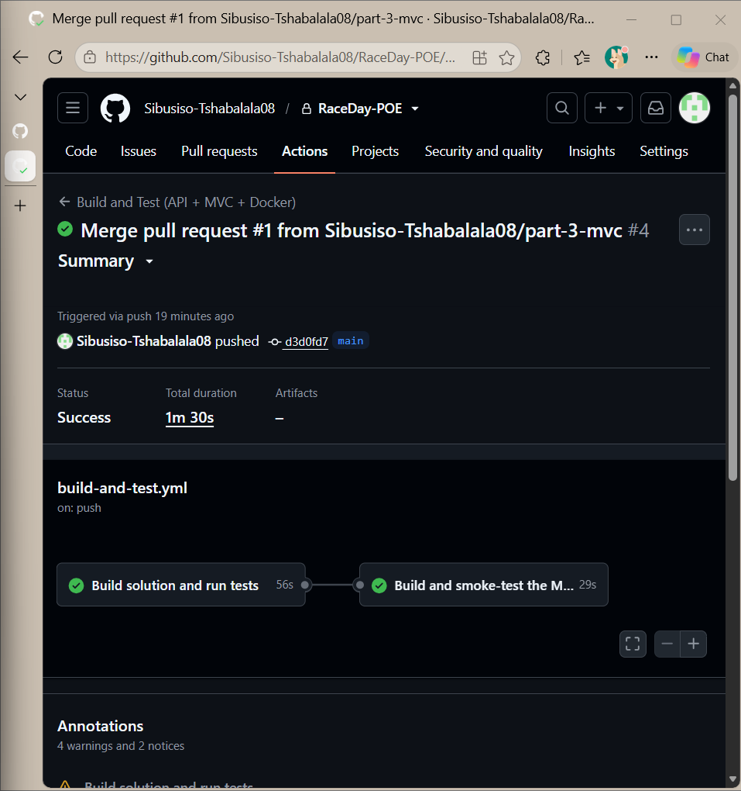

# RaceDay — Event Management System

## Overview

RaceDay is a full-stack, web-based event management system built for South Africa's road running, walking, and cycling community. It replaces the paper-based registration, spreadsheets, and disconnected communication that many local race organisers currently rely on.

The platform allows **Event Organisers** to create and manage events, define entry categories, and capture participant results. **Participants** can browse upcoming events, enter events by selecting a category, track their personal performance history, and prepare for race day using live weather and route information.

This repository contains all three parts of the RaceDay Portfolio of Evidence: **Part 1** system planning (ERD, API endpoint plan, SQL script), **Part 2** the RESTful API, and **Part 3** the MVC web application with Azure Blob Storage and Docker. Each part builds on the one before it; scroll down to the part you want.

## User Roles

RaceDay supports two distinct user roles:

- **Organiser** — can create, edit, and delete events; manage event categories; capture participant results; and view all enrolments for their own events.
- **Participant** — can create an account, browse events, enter an event by selecting a category, view their own enrolments, and track their own results.

Role-based access will be enforced at the API level in Part 2 and reflected consistently in the MVC interface in Part 3.

## Repository Structure

```
├── .github/workflows/
│   ├── validate-repo-structure.yml   # CI: checks required files for Parts 1-3
│   └── build-and-test.yml            # CI: builds API + MVC, runs tests, builds the Docker image
├── docs/                             # Part 1 planning documents, video scripts, CI screenshot
├── RaceDay.Api/                      # Part 2 + 3: ASP.NET Core Web API (also talks to Azure Blob Storage)
├── RaceDay.Api.Tests/                # xUnit tests for the API
├── RaceDay.Web/                      # Part 3: ASP.NET Core MVC web app (talks ONLY to the API)
│   └── Dockerfile
├── docker-compose.yml
├── RaceDay.sln
└── README.md
```

## Part 1 Deliverables

### 1. Entity Relationship Diagram
Located at `docs/RaceDay_ERD.png`. Models 6 entities: `Roles`, `Users`, `Events`, `Categories`, `Enrolments`, and `Results`, with primary keys, foreign keys, and cardinality shown for every relationship.

A few deliberate design decisions worth noting:
- `Users` is a single table with a `RoleId` foreign key (rather than separate Organiser/Participant tables), since both roles share identical attributes — the difference in permissions is enforced at the application layer, not the schema layer.
- `Events` includes `Latitude`/`Longitude` (to support the live weather feature) and `RouteMapUrl` (to support Azure Blob Storage integration in Part 3), even though those features aren't built until later parts — this avoids schema changes further into the project.
- `Categories` supports **both** age-based (e.g. "Under 20", "Senior") and distance-based (e.g. "10km", "21km") categories via a `CategoryType` field, with `Distance` or `MinAge`/`MaxAge` populated accordingly. This is enforced with a `CHECK` constraint in the SQL script.
- `Enrolments` enforces one enrolment per participant per category via a `UNIQUE(ParticipantId, CategoryId)` constraint.
- `Results` has a `Status` field (Finished/DNF/DNS/DQ) and nullable `FinishTime`/`Position`, since not every participant who enrols finishes the race.

### 2. API Endpoint Plan
Located at `docs/RaceDay_API_Endpoint_Plan.md`. Covers all required areas — Authentication, User Profile, Events, Categories, Event Enrolments, and Results — with HTTP method, route, description, required role, request body, and expected response (including failure cases) specified for every endpoint.

### 3. SQL Database Script
Located at `docs/RaceDay_Database.sql`.

## Setup Instructions — Running the Database Script

1. Open **SQL Server Management Studio (SSMS)** and connect to your local or remote SQL Server instance.
2. Open a new query window.
3. Open `docs/RaceDay_Database.sql` and execute it.
4. The script will:
   - Create a new `RaceDay` database (if one doesn't already exist)
   - Create all 6 tables with primary keys, foreign keys, and constraints
   - Seed the database with sample data: 2 Organisers, 2 Participants, 3 Events, 6 Categories, 4 Enrolments, and 3 Results
5. To verify, expand **Databases → RaceDay → Tables** in Object Explorer, or run:
   ```sql
   SELECT * FROM RaceDay.dbo.Events;
   ```

No additional setup (no application code, no dependencies) is required for Part 1, since this part is planning and database design only.

## CI/CD

A GitHub Actions workflow (`.github/workflows/validate-repo-structure.yml`) runs automatically on every push to `main` (and on `part-3*` branches). It validates that the `/docs` folder exists and contains the ERD, API endpoint plan, and SQL script, that a README is present, and (from Part 3) that the MVC project and Dockerfile exist.

**Successful build:**

<!-- Paste your screenshot of the green GitHub Actions build here, e.g.: -->
<!--  -->

## Video Walkthrough

An unlisted YouTube video walking through the planning documents, ERD design decisions, endpoint plan choices, and a live run of the SQL script in SSMS:

<!-- Paste your unlisted YouTube link here -->
**[Video link here]**

---

## Part 2 — RESTful API

### What Part 2 Implements

A RESTful API built with ASP.NET Core Web API (C#), following the endpoint plan approved in Part 1 exactly — every route, role, and failure case from `docs/RaceDay_API_Endpoint_Plan.md` is implemented here.

**Database:** Entity Framework Core, Code-First. The model classes in `RaceDay.Api/Models/` and the Fluent API configuration in `RaceDay.Api/Data/RaceDayDbContext.cs` reproduce the Part 1 ERD and SQL script field-for-field — including the `CHECK` constraints (event type, category type/age/distance combination) and `UNIQUE` constraints (one email per user, one enrolment per participant per category, one result per enrolment) from Part 1's Section C.

**Authentication:** Session-based, not token-based. On login, the server stores `UserId` and `Role` in a server-side session (`RaceDay.Api/Auth/RequireSessionAttribute.cs`), and every subsequent request is authenticated and authorized from that session — matching the brief's explicit requirement for "session management to maintain the user's authenticated state and role." Passwords are hashed with BCrypt and never stored in plain text.

**Role enforcement:** A custom `[RequireSession]` authorization attribute enforces both "must be logged in" (401 if not) and "must be the right role" (403 if wrong role) on every protected endpoint — for example, only the Organiser who created an event can edit or delete it; only a Participant can enrol in a category.

**Weather integration:** `GET /api/events/{id}/weather` calls the free Open-Meteo API using the event's `Latitude`/`Longitude` from the Part 1 ERD, fulfilling the background brief's "live weather information" feature a full part ahead of when it was strictly due.

### Setup Instructions

**Prerequisites:** .NET 8 SDK, SQL Server (or SQL Server Express/LocalDB), and the EF Core CLI tool.

1. Clone the repository and restore dependencies:
   ```
   dotnet restore RaceDay.sln
   ```

2. Update the connection string in `RaceDay.Api/appsettings.json` if your SQL Server instance isn't on `localhost` with Windows/Trusted authentication.

3. **Generate the initial migration** (not committed to source control, since it must be generated against your own environment the first time):
   ```
   cd RaceDay.Api
   dotnet tool install --global dotnet-ef   (if not already installed)
   dotnet ef migrations add InitialCreate
   ```

4. Run the API:
   ```
   dotnet run --project RaceDay.Api
   ```
   On first run, the database is created automatically (via `Database.Migrate()`), and seed data is inserted — matching Part 1's Section C: 2 Organisers, 2 Participants, 3 Events, 6 Categories, 4 Enrolments, 3 Results.

5. Open Swagger UI at `https://localhost:5001/swagger` (or `http://localhost:5000/swagger`) to view and test every endpoint directly in the browser.

   **Seeded test accounts** (password for all: `Password123!`):
   - Organiser: `thabo.nkosi@raceday.co.za`
   - Participant: `sarah.vdm@example.com`

### Running the Tests

```
dotnet test RaceDay.Api.Tests/RaceDay.Api.Tests.csproj
```

23 tests across 4 test classes, covering both expected success and expected failure scenarios for every required area from the Part 2 brief:
- `AuthTests` — registration and login (valid/invalid roles, duplicate email, wrong password, protected routes without a session)
- `EventManagementTests` — Organiser create/update/delete, ownership enforcement, invalid event types
- `RoleEnforcementTests` — Participants rejected from Organiser-only actions and vice versa, anonymous requests rejected
- `EnrolmentTests` — correct Participant+Category+Event linkage, duplicate enrolment rejection, full-category rejection, Organiser visibility into their event's enrolments

Tests run against a real HTTP pipeline (via `WebApplicationFactory`) backed by an isolated EF Core in-memory database per test class, so they exercise the actual controllers, routing, and session middleware — not mocks.

### CI/CD

A second GitHub Actions workflow (`.github/workflows/build-and-test.yml`) runs on every push to `main`: it restores, builds the full solution, and runs all unit tests. A failing test fails the build.

**Successful build:**

<!-- Paste your screenshot of the green Part 2 GitHub Actions build here, e.g.: -->
<!--  -->

### Video Walkthrough

An unlisted YouTube video demonstrating the running API, explaining the code structure, endpoints, authentication, and unit tests:

<!-- Paste your unlisted YouTube link here -->
**[Video link here]**

---

## Part 3 — MVC Web Application, Azure Blob Storage and Docker

Part 3 adds `RaceDay.Web`, an ASP.NET Core MVC app that gives Organisers and Participants a RaceDay-branded website. **It contains no database code and no business rules:** every read and write goes through the Part 2 REST API with a typed `HttpClient` (`RaceDay.Web/Services/ApiClient.cs`). Images are uploaded to the **API**, which stores them in **Azure Blob Storage** and saves the URL in the database. The MVC app never talks to Azure.

```
Browser ──► RaceDay.Web (MVC, Docker, :8080) ──HTTP + session cookie──► RaceDay.Api (:5000) ──► SQL Server
                                                                                  └──────────► Azure Blob Storage
```

### Features

| Area | What you get |
|---|---|
| **Sign-up / login** | Register as Organiser or Participant; login calls the API. The MVC session remembers the user's id, role and the API session cookie. Logout ends both sessions. |
| **Role-based navigation** | Organisers see Dashboard / Events / Enrolments / Results. Participants see Find events / My events / My results. Visiting a page for the other role shows an "access denied" page; visiting any page while logged out redirects to login and returns you afterwards. |
| **Organiser** | Dashboard (totals, enrolments per event, upcoming dates) · create / edit / delete events with banner upload · age and distance categories · enrolments per event · enter finish time, position and status per participant. |
| **Participant** | Home with upcoming events and filters (search, type, distance) · event detail with categories and live weather · enrol in a category · My events with colour-coded status · My results (e.g. "47th out of 312 finishers") · profile with picture upload. |
| **Azure Blob Storage** | Event banners and profile pictures are validated (type, size, real image bytes) and uploaded by the API; the blob URL is stored on the `Events` / `Users` row and shown in the MVC pages. |
| **Docker** | Multi-stage `Dockerfile`; the container behaves exactly like a local run. |
| **UI** | Bootstrap 5 + a custom RaceDay theme. Statuses are colour-coded: green = Confirmed / Finished, amber = Pending / DNF, red = Cancelled / DQ. Invalid input is explained next to the field; API or server problems show a friendly page, never a stack trace. |

### Prerequisites

- .NET 8 SDK, SQL Server / LocalDB, `dotnet-ef` (`dotnet tool install --global dotnet-ef`)
- Docker Desktop (for the container)
- An Azure Storage account (only needed for image uploads — everything else works without it)

### 1. Set up Azure Blob Storage (one-off)

1. In the [Azure portal](https://portal.azure.com) create a **Storage account** (Standard, LRS; any name).
2. Open the account → **Settings → Configuration** → set **Allow Blob anonymous access = Enabled** → Save. (The API creates a container whose blobs are publicly readable so the browser can display the images.)
3. Open **Security + networking → Access keys** → copy a **Connection string**.
4. Give the API the connection string **as a secret — never commit it**:
   ```
   dotnet user-secrets init --project RaceDay.Api
   dotnet user-secrets set "AzureStorage:ConnectionString" "<paste connection string>" --project RaceDay.Api
   ```
   (In a deployed environment use the environment variable `AzureStorage__ConnectionString`.) The container name defaults to `raceday-images`; override with `AzureStorage:ContainerName`.

If no connection string is set, uploads fail politely ("image storage isn't configured") and the rest of the site keeps working.

### 2. Run the API

```
dotnet ef migrations add InitialCreate --project RaceDay.Api     # first time only (not committed)
dotnet run --project RaceDay.Api --urls http://0.0.0.0:5000
```

`0.0.0.0` lets the Docker container reach the API on your machine (Windows may ask you to allow it through the firewall — choose *Private networks*). The API uses its own database, `RaceDayApi` (separate from the `RaceDay` database created by the Part 1 SQL script). If you already created `RaceDayApi` while doing Part 2, drop it once so the new image-URL columns are created: `dotnet ef database drop --project RaceDay.Api --force`, then run the API again.

### 3a. Run the MVC app locally (no Docker)

```
dotnet run --project RaceDay.Web
```
Open **http://localhost:5100**. The API address is `ApiBaseUrl` in `RaceDay.Web/appsettings.json` (default `http://localhost:5000/`).

### 3b. Run the MVC app in Docker

From the repository root, with the API already running (step 2):

```
docker build -f RaceDay.Web/Dockerfile -t raceday-web .
docker run --rm -p 8080:8080 -e ApiBaseUrl=http://host.docker.internal:5000/ raceday-web
```
Open **http://localhost:8080** — identical behaviour to the local run. Or, in one command:
```
docker compose up --build
```
`host.docker.internal` is how a container reaches a service on your own machine (built in on Docker Desktop for Windows and Mac; the compose file adds it for Linux).

**Test accounts** (seeded by the API, password `Password123!`): Organiser `thabo.nkosi@raceday.co.za`, Participant `sarah.vdm@example.com`.

### Design notes

- **Session handling.** The API authenticates with a server-side session cookie. The MVC server is the API's *client*, so `ApiSessionHandler` captures the API's session cookie at login, stores it in that user's MVC session, and attaches it to every later API call. The HttpClient's own cookie jar is disabled, so one user's session can never leak to another. When the API session expires (30 min idle) a 401 sends the user back to login.
- **Role protection** is enforced twice: the MVC `[RequireLogin("Organiser")]` filter gives a good experience, and the API's `[RequireSession]` filter is the real security boundary.
- **Anti-forgery tokens** are required on every POST. **Passwords** are hashed by the API (BCrypt).
- **Culture.** The app pins the invariant culture so decimals such as `10.5` bind correctly on South African (comma-decimal) machines and inside Docker.

### Tests

`dotnet test RaceDay.Api.Tests` — 35 tests (23 from Part 2 plus 12 new): banner and profile-picture upload (success, wrong role, someone else's event, not logged in, non-image file, fake image bytes) with a fake blob service, the organiser dashboard summary endpoint, and the participant results endpoint with finisher totals.

### Part 3 CI/CD

`.github/workflows/build-and-test.yml` restores and builds the **whole solution including `RaceDay.Web`**, runs all tests, publishes the MVC app, then builds the Docker image and starts it as a smoke test. `validate-repo-structure.yml` checks the Part 1–3 files, that the MVC project has no database/Azure packages, and that no storage key was committed.

**Successful build:**

<!-- Paste your screenshot of the green Part 3 GitHub Actions run here, e.g.: -->
<!--  -->


### Part 3 Video Walkthrough

An unlisted YouTube video showing the running app for both roles, the MVC code structure, Azure Blob Storage integration and the Docker setup:

**[Watch the Part 3 demo video](https://youtu.be/H3swFvX7en4)** 
